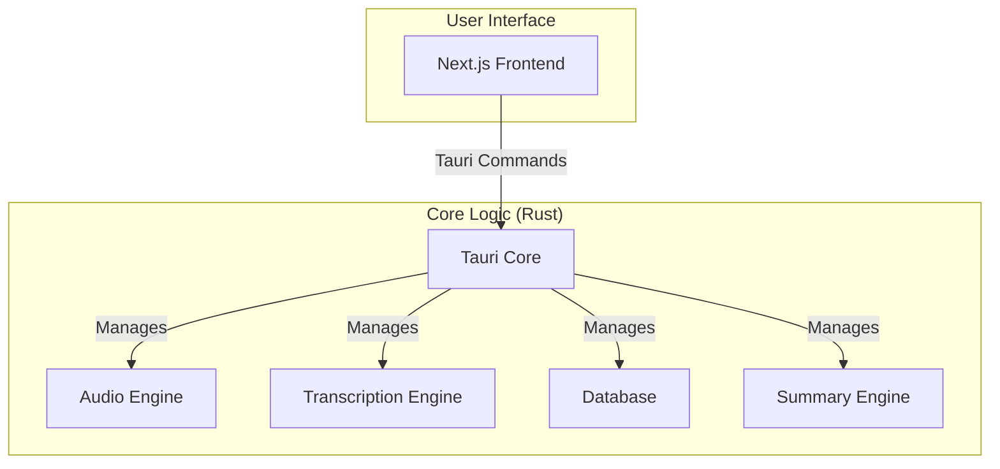

# System Architecture

Meetily is a self-contained desktop application built with [Tauri](https://tauri.app/). It combines a Rust-based backend with a Next.js frontend into a single, efficient, and cross-platform application.

## High-Level Architecture Diagram

## Component Details

### Frontend (Next.js)

*   Provides the user interface for managing meetings, displaying transcriptions, and configuring the application.
*   Communicates with the Rust core through Tauri's command system.

### Backend (Rust Core)

*   **Tauri Core:** The heart of the application, responsible for managing the window, handling events, and exposing the Rust core to the frontend.
*   **Audio Engine:** Captures audio from the microphone and system, processes it, and prepares it for transcription.
*   **Transcription Engine:** Transcribes the captured audio through a pluggable provider. By default it runs a local speech-to-text model (Whisper or Parakeet), which can be GPU-accelerated; alternatively it can delegate to a self-hosted, OpenAI-compatible Whisper server on the user's own network.
*   **Database:** A local SQLite database that stores meeting metadata, transcripts, and summaries.
*   **Summary Engine:** Generates meeting summaries using various Large Language Models (LLMs), including local models via Ollama.

## Frontend and Native Communication

The supported application uses Tauri commands and events, not a separate FastAPI service. The Python/FastAPI, Docker, and standalone whisper-server code under `backend/` is an unsupported legacy archive.

- Frontend code calls Rust commands with `invoke` from `@tauri-apps/api/core`. Command registration lives in [lib.rs](../frontend/src-tauri/src/lib.rs); implementations delegate to the relevant Rust service.
- Rust emits events through Tauri, and frontend listeners update React state. Check the current command arguments and event payloads before changing either side of the interface.
- [SidebarProvider.tsx](../frontend/src/components/Sidebar/SidebarProvider.tsx) manages meeting navigation and summary polling, and uses the recording-state context. Preserve the existing state ownership rather than introducing a second source of truth.

## Audio Pipeline

[pipeline.rs](../frontend/src-tauri/src/audio/pipeline.rs) receives asynchronous microphone and system-audio chunks, converts input to mono, resamples when necessary, and buffers samples for mixing.

The mixed audio has two consumers with different requirements:

- **Recording:** mixed audio is sent to [recording_saver.rs](../frontend/src-tauri/src/audio/recording_saver.rs), which uses incremental saving and tracks recording metadata and transcript segments.
- **Transcription:** [vad.rs](../frontend/src-tauri/src/audio/vad.rs) selects speech segments and resamples them for the transcription workers. Silence filtering must not remove audio from the recording output.

The input-processing target is 48 kHz; VAD-selected transcription segments are sent at 16 kHz. Timing and buffering settings belong to the implementation, so inspect the current code rather than assuming a fixed mixing-window duration. During shutdown, the pipeline drains its channel and flushes remaining speech before completing.

On Linux, [pulse_linux.rs](../frontend/src-tauri/src/audio/capture/pulse_linux.rs) captures microphone and system audio through the PulseAudio protocol, including on PipeWire. It dispatches pending mainloop events in bounded nonblocking bursts, sleeping only when idle, so capture can keep up without starving sample delivery or stop checks.

For audio changes, start in the relevant subsystem:

- Device discovery and platform configuration: [devices/](../frontend/src-tauri/src/audio/devices/).
- Stream capture and platform integration: [capture/](../frontend/src-tauri/src/audio/capture/) and [stream.rs](../frontend/src-tauri/src/audio/stream.rs).
- Recording lifecycle: [recording_manager.rs](../frontend/src-tauri/src/audio/recording_manager.rs) and [recording_commands.rs](../frontend/src-tauri/src/audio/recording_commands.rs).
- Mixing and speech segmentation: [pipeline.rs](../frontend/src-tauri/src/audio/pipeline.rs) and [vad.rs](../frontend/src-tauri/src/audio/vad.rs).
- Provider dispatch and transcript emission: [transcription/](../frontend/src-tauri/src/audio/transcription/).

## Transcription and Model Management

Local speech recognition is implemented through the Whisper and Parakeet providers under [audio/transcription/](../frontend/src-tauri/src/audio/transcription/). Whisper model discovery, downloads, loading, and cached context are managed by [whisper_engine.rs](../frontend/src-tauri/src/whisper_engine/whisper_engine.rs).

Model directories and acceleration behavior depend on application configuration and the compiled backend. Use the current initialization and loading code as the source of truth rather than hardcoding storage paths or assuming runtime GPU fallback. See the [build instructions](BUILDING.md) and [GPU acceleration guide](GPU_ACCELERATION.md) for platform setup.
